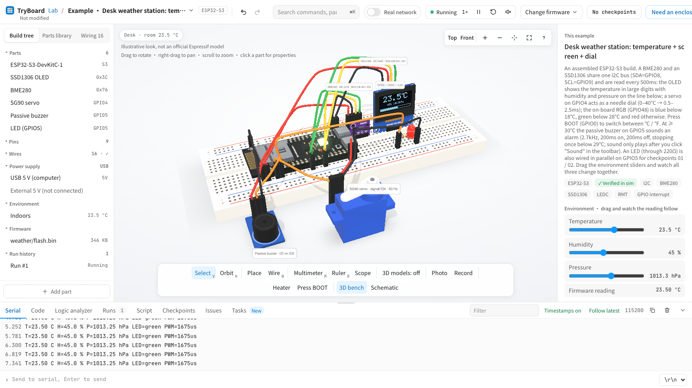

<div align="center">


# TryBoard

**Run your real ESP32 firmware in the browser before you buy the board.**

English · [简体中文](docs/readme/README.zh-CN.md) · [日本語](docs/readme/README.ja.md) · [한국어](docs/readme/README.ko.md)

[](core)
[](docs/STATUS.md)
[](https://github.com/espressif/esp-idf)
[](https://threejs.org)
[](docs/I18N.md)
[](LICENSE)

</div>

---



TryBoard is an instruction-level ESP32 simulator with a 3D workbench. Drop in the `flash.bin` that ESP-IDF or
Arduino produced, wire parts on a breadboard, and watch the same binary blink LEDs, drive servos, draw on displays
and talk Wi-Fi or BLE — **deterministically**, so every run of the same firmware gives the same result and can be
checked like a test.

It is built for people who write firmware with AI: the site gives you a task brief and pass criteria, your AI writes
the code, and TryBoard tells you whether it works, which chip and parts to buy, and which risks only real hardware
can rule out.

## Three layers

**Core — runs the real binary.** A from-scratch RV32IMC and Xtensa LX6/LX7 emulator in Rust, compiled to wasm.
It boots unmodified ESP-IDF images against the original mask ROM, with FreeRTOS scheduling, dual-core S3, PSRAM, and
peripheral models checked against QEMU and ESP-IDF test output.

**World — sensors read the scene.** A three.js workbench (WebGPU first, WebGL2 fallback) with boards, breadboard,
parts and a room. Ultrasonic sensors cast rays, IMUs read physics, displays render the framebuffer, buzzers play
through Web Audio, and a virtual phone scans, connects to and subscribes to your BLE peripheral.

**Decision — what to buy.** A selection advisor turns a project into chip, board, BOM, pin map and power estimate.
Every conclusion carries a trust label:

| Label | Meaning |
|---|---|
| Simulated | Real firmware runs on the instruction-level core; the peripheral model has acceptance tests |
| Behavioural | The outside world is modelled at behaviour level (virtual phone, virtual Wi-Fi network) |
| Estimated | Power, timing margins, wiring loss from datasheets and calibrated models |
| Needs hardware | RF range, antennas, analog noise, strict timing — verify on a real board |

## What runs today

| Area | ESP32-C3 | ESP32-S3 | ESP32 |
|---|---|---|---|
| CPU, interrupts, timers, FreeRTOS | ✅ RV32IMC | ✅ LX7, dual core, PSRAM | ✅ LX6, dual core |
| GPIO, UART, LEDC (PWM) | ✅ | ✅ | ✅ |
| I2C with virtual SSD1306 / BME280 | ✅ | ✅ (+ MPU6050, QMI8658, touch panels) | ✅ |
| ADC, RMT (WS2812, ultrasonic), SPI LCD, I2S | ✅ | ✅ (+ PCNT encoder) | — |
| USB HID keyboard / CDC | — | ✅ | — |
| Wi-Fi (open, WPA2-PSK, HTTP) | ✅ | ✅ | init only |
| BLE peripheral (NimBLE) + virtual phone | ◐ behavioural | — | — |

Full matrix with acceptance evidence: **[docs/STATUS.md](docs/STATUS.md)**. <!-- stats:accept -->244<!-- /stats --> acceptance cases, <!-- stats:examples -->72<!-- /stats --> examples and a
7-level learning path run on every batch (`tools/accept.sh`).

## Quick start

```bash
tools/fetch_third_party.sh          # ROM ELFs (Apache-2.0) and riscv-tests, into third_party/
tools/build_web.sh                  # wasm core + web assets
cd web && npm install && npm run dev   # http://localhost:5180
```

Run firmware from the command line, with parts attached:

```bash
cd core
cargo run -p tryboard-cli --release -- run ../firmware/build/blink/flash.bin
cargo run -p tryboard-cli --release -- run ../firmware/build/weather/flash.bin \
  --i2c ssd1306@0x3c,bme280@0x76 --env 23.5,45,101325 --oled
tools/check.py ../firmware/build/blink/flash.bin --level 01   # pass/fail against a level
```

Building the acceptance firmware needs ESP-IDF v5.5 (`tools/build_fw.sh`). Requirements: Rust with
`wasm32-unknown-unknown`, Node 22.18+, Python 3.11+.

## Layout

```
core/       Rust workspace: rv32, xtensa, soc, esp32c3, esp32s3, esp32, elec, cli, wasm
web/        Vite + TypeScript + React + three.js front end; i18n in web/src/i18n
firmware/   ESP-IDF acceptance firmware, examples.json, levels.json
tools/      build, acceptance, QEMU oracle, web regression tests
docs/       architecture, plan, design, licensing decisions
```

Contributions are welcome: read **[CONTRIBUTING.md](CONTRIBUTING.md)** first (coding agents also follow
**[AGENTS.md](AGENTS.md)**). Please report security issues privately as described in [SECURITY.md](SECURITY.md).

## Status and roadmap

TryBoard is **alpha** (v0.1.0): the core runs real firmware and the acceptance suite is green, but APIs, file
formats and the web UI still change between releases. Release notes are in [CHANGELOG.md](CHANGELOG.md).

| Milestone | State |
|---|---|
| ESP32-C3 core, GPIO, web workbench | ✅ done |
| Common peripherals (LEDC, RMT, I2C, SPI, ADC, timers) | ◐ most models done |
| ESP32-S3 (LX7) and classic ESP32 (LX6) | ◐ boots IDF, most peripherals |
| USB OTG (HID / CDC done, network adapter next) | ◐ |
| Wi-Fi and BLE against virtual networks / phones | ◐ |
| Audio and camera (I2S, Web Audio, camera reads the 3D scene) | ☐ planned |
| Selection advisor, learning path, launch | ◐ |

Item-level plan with acceptance criteria: [docs/PLAN.md](docs/PLAN.md).

## Acknowledgements

TryBoard stands on the work of many open projects:

- **Espressif** — [ESP-IDF](https://github.com/espressif/esp-idf), [esp-rom-elfs](https://github.com/espressif/esp-rom-elfs),
  [esp_lcd_gc9a01](https://components.espressif.com/components/espressif/esp_lcd_gc9a01),
  [esp_lvgl_port](https://github.com/espressif/esp-bsp) and the
  [Espressif QEMU fork](https://github.com/espressif/qemu), used only as an independent reference process
- **RISC-V** — [riscv-tests](https://github.com/riscv-software-src/riscv-tests) for CPU conformance
- **Graphics & UI** — [three.js](https://threejs.org), [three-mesh-bvh](https://github.com/gkjohnson/three-mesh-bvh),
  [Manifold](https://github.com/elalish/manifold), [React](https://react.dev), [Radix UI](https://www.radix-ui.com),
  [Tailwind CSS](https://tailwindcss.com), [Vite](https://vite.dev), [LVGL](https://lvgl.io)
- **Electrical reference** — [ngspice](https://ngspice.sourceforge.io)
- **3D models** — [KiCad libraries](https://gitlab.com/kicad/libraries/kicad-packages3D) (CC BY-SA 4.0) and
  [Adafruit CAD Parts](https://github.com/adafruit/Adafruit_CAD_Parts) (MIT), converted with
  [occt-import-js](https://github.com/kovacsv/occt-import-js), [glTF-Transform](https://gltf-transform.dev) and
  [meshoptimizer](https://github.com/zeux/meshoptimizer)
- **Fonts** — [Noto Sans SC](https://fonts.google.com/noto/specimen/Noto+Sans+SC) and
  [JetBrains Mono](https://www.jetbrains.com/lp/mono/) (SIL OFL 1.1)

Per-file sources, copyright lines and licence texts are generated into `THIRD_PARTY_NOTICES.txt` and the `/licenses`
page; the rules behind them are in [docs/LICENSING.md](docs/LICENSING.md).

## Notes

TryBoard is an independent project and is not affiliated with or endorsed by Espressif Systems. "ESP32" names the chip
family it simulates; 3D boards are illustrations, not official Espressif models. Compatible with Arduino-built
firmware. Simulation results are not calibrated against real silicon unless stated.

## License

TryBoard is licensed under the [Apache License 2.0](LICENSE); see also [NOTICE](NOTICE). Third-party 3D models
(CC BY-SA 4.0 / MIT), fonts (SIL OFL 1.1) and the inputs fetched into `third_party/` keep their own licences, listed in
`assets/models/*/SOURCES.md` and `THIRD_PARTY_NOTICES.txt`.
